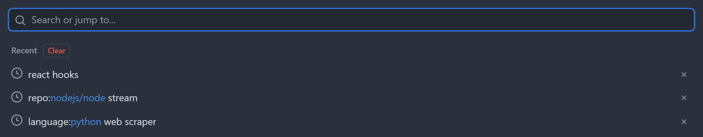

# GitHub Search History Cleaner

English | [繁體中文](#繁體中文)

A browser extension that lets you delete entries from the **Recent** section of the GitHub search box, one at a time or all at once. GitHub itself offers no way to do this.



It adds two controls to the search dropdown:

- a **Clear** button next to the "Recent" heading, which deletes every recent search
- a **×** button on each recent search, which deletes only that one

## Install

The extension is not in the Chrome Web Store, so it is loaded from this folder.

1. Download or clone this folder.
2. Open `chrome://extensions` (in Microsoft Edge, `edge://extensions`) and turn on **Developer mode**.
3. Click **Load unpacked** and select the folder.
4. Reload any GitHub tabs that were already open.

It was built for and tested in Chrome. Other Chromium browsers that support Manifest V3 extensions, such as Microsoft Edge, should work the same way.

## Use

Click the GitHub search box (or press `/`) with nothing typed in it, so that the Recent section shows.

| Control | What it does |
| --- | --- |
| **×** on an entry | Deletes that search and hides it. |
| **Clear** | Turns into **Confirm?**. Click again within 4 seconds to delete all recent searches; otherwise it turns back into Clear. |

After Clear deletes everything, the page reloads so that the search box shows the result. If the page has a text box with something typed in it, such as an unfinished comment or issue, the page is not reloaded and the entries are hidden instead.

If a **×** turns into **?**, the extension could not find that entry in the browser's storage and deleted nothing. Clear still works in that case.

## Privacy

- The extension requests no permissions and runs only on `https://github.com/*`.
- It makes no network requests.
- GitHub keeps recent searches in the browser, under the `localStorage` key `github-search-history`. That key is the only data the extension reads or changes. Deleting an entry removes it from this browser only.

## Limitations

- The buttons are attached by recognising the search dropdown's structure: a heading whose text is exactly `Recent`, followed by entries marked `role="option"`. If GitHub changes that structure, the buttons may stop appearing until `content.js` is updated.
- The check for unsaved text only looks at visible text areas. It does not detect unsaved changes in GitHub's file editor, so finish or save an edit there before using Clear.

## Development

| File | Purpose |
| --- | --- |
| `manifest.json` | Extension manifest (Manifest V3). |
| `content.js` | All of the logic. It runs on every GitHub page and has no dependencies or build step. |
| `icons/` | PNG icons in four sizes and their SVG sources. |
| `docs/` | The screenshot shown in this README. Not used by the extension. |
| `test/` | Unit tests for the deletion logic. Not used by the extension. |

After editing a file, click the reload icon on the extension's card in `chrome://extensions`, then reload the GitHub tab.

The tests cover the code that decides which entries to remove from the stored history. They need Node.js 20 or later and nothing else:

```sh
node --test
```

They do not cover the buttons or anything else that depends on GitHub's page, so after a change also try the extension on GitHub itself.

The constants at the top of `content.js` hold the values most likely to need changing:

| Constant | Meaning |
| --- | --- |
| `HEADING_TEXT` | Text of the section heading to look for (`Recent`). |
| `KEY_RE` | Pattern matching the `localStorage` key that holds the history. |
| `RELOAD_AFTER_CLEAR` | Whether Clear reloads the page afterwards. |
| `CONFIRM_MS` | How long Clear waits for the confirming click. |

GitHub stores the history as a JSON array of query strings, newest first, for example `["puppeteer","repo:nodejs/node stream"]`. The deletion code also handles entries stored as objects, in case that format changes.

To change the icon, edit the SVG files and export them to PNG again. `icons/icon.svg` is the source for the 32, 48 and 128 pixel icons. `icons/icon16.svg` is a simplified drawing, aligned to the pixel grid, for the 16 pixel icon.

---

## 繁體中文

[English](#github-search-history-cleaner) | 繁體中文

這是一個瀏覽器擴充功能，讓你刪除 GitHub 搜尋框裡 **Recent**（最近搜尋）區塊的紀錄，可以一筆一筆刪，也可以一次全部清掉。GitHub 本身沒有提供這個功能。


它會在搜尋下拉選單裡加上兩種按鈕：

- 「Recent」標題旁的 **Clear** 按鈕：刪除所有最近搜尋
- 每筆搜尋紀錄右側的 **×** 按鈕：只刪除那一筆

### 安裝

這個擴充功能沒有上架 Chrome 線上應用程式商店，要從這個資料夾載入。

1. 下載或 clone 這個資料夾。
2. 開啟 `chrome://extensions`（Microsoft Edge 請開 `edge://extensions`），打開**開發人員模式**。
3. 按**載入未封裝項目**，選擇這個資料夾。Edge 上這個按鈕的名稱略有不同。
4. 重新整理原本已經開著的 GitHub 分頁。

它是針對 Chrome 開發並測試的。其他支援 Manifest V3 擴充功能的 Chromium 瀏覽器（例如 Microsoft Edge）應該也能用同樣的方式安裝。

### 使用方式

在沒有輸入任何文字的情況下點 GitHub 的搜尋框（或按 `/`），就會看到 Recent 區塊。

| 按鈕 | 作用 |
| --- | --- |
| 紀錄上的 **×** | 刪除那一筆搜尋並把它隱藏。 |
| **Clear** | 會先變成 **Confirm?**。4 秒內再按一次才會刪除所有最近搜尋，否則會變回 Clear。 |

Clear 刪除全部紀錄後會重新載入頁面，讓搜尋框顯示最新的結果。如果頁面上有已經輸入內容的文字框（例如寫到一半的留言或 issue），就不會重新載入，而是直接把紀錄隱藏。

如果 **×** 變成 **?**，代表擴充功能在瀏覽器的儲存空間裡找不到那筆紀錄，沒有刪除任何東西。這時仍然可以用 Clear。

### 隱私

- 這個擴充功能不要求任何權限，只在 `https://github.com/*` 執行。
- 它不會發出任何網路請求。
- GitHub 把最近搜尋存在瀏覽器裡，位置是 `localStorage` 的 `github-search-history`。擴充功能只會讀取或修改這一項資料。刪除紀錄只影響這個瀏覽器。

### 限制

- 按鈕是靠辨識搜尋下拉選單的結構加上去的：一個文字剛好是 `Recent` 的標題，後面接著標有 `role="option"` 的項目。如果 GitHub 改了這個結構，按鈕可能不再出現，要等 `content.js` 更新。
- 判斷有沒有未送出的文字時，只會檢查看得見的文字框。它偵測不到 GitHub 檔案編輯器裡尚未儲存的修改，所以在那裡編輯時，請先完成或儲存再按 Clear。

### 開發

| 檔案 | 用途 |
| --- | --- |
| `manifest.json` | 擴充功能的 manifest（Manifest V3）。 |
| `content.js` | 所有的程式邏輯。它在每個 GitHub 頁面上執行，沒有相依套件，也不需要建置。 |
| `icons/` | 四種尺寸的 PNG 圖示與 SVG 原稿。 |
| `docs/` | 這份 README 用的截圖，擴充功能本身不會用到。 |
| `test/` | 刪除邏輯的單元測試，擴充功能本身不會用到。 |

修改檔案後，到 `chrome://extensions` 按擴充功能卡片上的重新載入圖示，再重新整理 GitHub 分頁。

測試涵蓋的是「決定要從儲存的搜尋紀錄移除哪幾筆」的程式。執行只需要 Node.js 20 以上，不用安裝其他東西：

```sh
node --test
```

測試不包含按鈕或其他依賴 GitHub 頁面的部分，所以修改之後也請在 GitHub 上實際操作一次。

`content.js` 開頭的常數是最可能需要調整的設定：

| 常數 | 意義 |
| --- | --- |
| `HEADING_TEXT` | 要尋找的區塊標題文字（`Recent`）。 |
| `KEY_RE` | 用來比對存放搜尋紀錄的 `localStorage` key 的樣式。 |
| `RELOAD_AFTER_CLEAR` | Clear 之後是否重新載入頁面。 |
| `CONFIRM_MS` | Clear 等待第二次點擊確認的時間。 |

GitHub 把搜尋紀錄存成查詢字串的 JSON 陣列，新的在前，例如 `["puppeteer","repo:nodejs/node stream"]`。刪除的程式也能處理以物件儲存的紀錄，以防這個格式日後改變。

要修改圖示，請編輯 SVG 檔再重新匯出成 PNG。`icons/icon.svg` 是 32、48、128 像素圖示的原稿；`icons/icon16.svg` 是給 16 像素圖示用的簡化版，線條對齊像素格。
